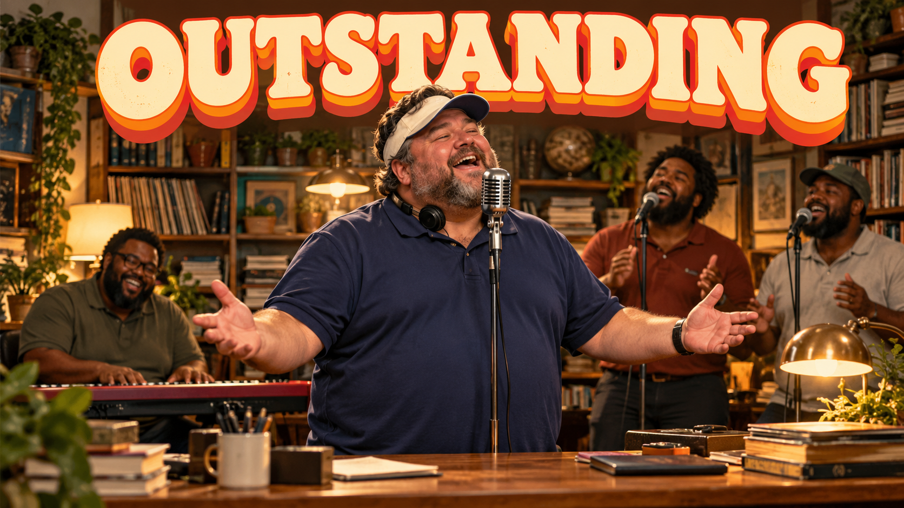
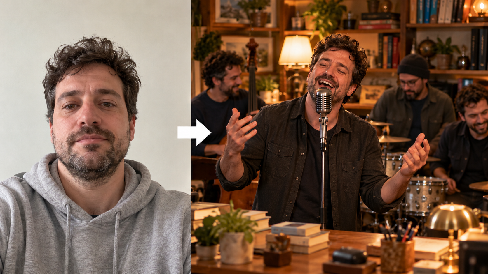
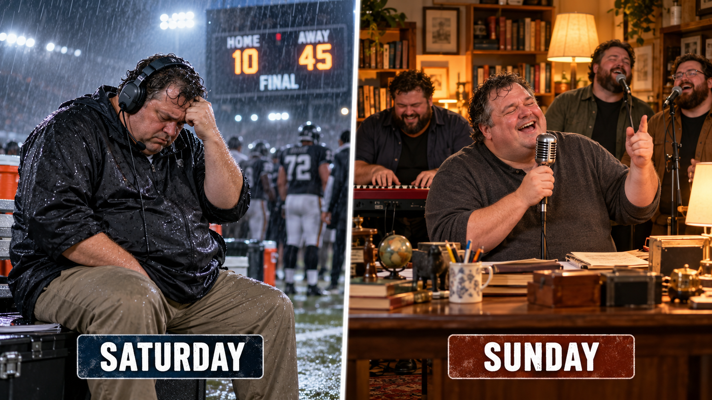
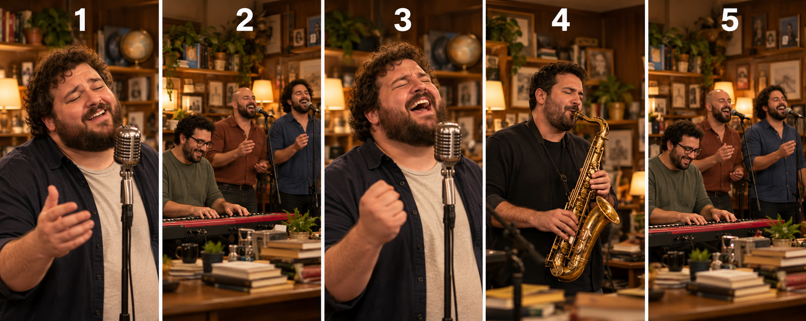
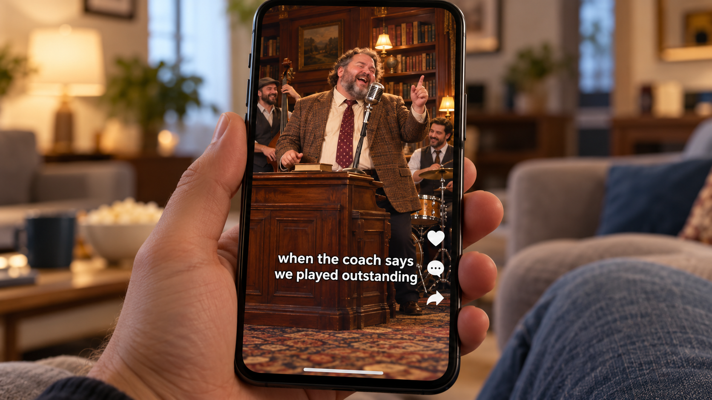

# Outstanding Tiny Desk AI Video Guide

How to make the viral **Outstanding Tiny Desk AI video**: the meme where a coach, a teammate or a friend takes over the lead vocals at the end of Charlie Wilson's NPR Tiny Desk concert. This repo collects a Seedance 2.5 workflow, copy-ready prompts, caption ideas and a no-prompt shortcut.

> All images in this repo are AI-generated and show fictional people. This is an independent guide and is not affiliated with NPR, Tiny Desk, Charlie Wilson, The Gap Band or ByteDance.

## The fastest way: photos in, video out

If you just want the video, [Tiny Desk AI](https://tinydesk-ai.com/?utm_source=github&utm_medium=referral&utm_campaign=readme) makes the full 19-second version from one to five photos: one for the lead singer, up to four friends for keys, sax and the backing singers. Confirm that everyone agreed, and download a vertical 9:16 MP4 with the original song, ready for TikTok, Reels and Shorts. You don't need a prompt or an editor.

## What the trend is

- **The clip:** the end of Charlie Wilson's NPR Tiny Desk concert (published 5 June 2023).
- **The song:** "Outstanding" by The Gap Band (1982, *Gap Band IV*).
- **The joke:** after a brutal college football weekend in October 2026, creators put the losing coaches behind the desk, singing about being "outstanding". Then everyone made one: players, rival fans, coworkers, dads.

For real results, render times and what it costs for one to five people, see [What Is Tiny Desk AI?](https://huggingface.co/blog/akagease/what-is-tiny-desk-ai) on Hugging Face.

## The clip has five shots

| Shot | Time (approx.) | On screen |
| :--- | :--- | :--- |
| 1 | 0 – 1.4 s | Lead singer close-up |
| 2 | 1.4 – 6.7 s | Keys player and two backing singers |
| 3 | 6.7 – 13.0 s | Lead singer, long close-up |
| 4 | 13.0 – 16.4 s | Saxophone player |
| 5 | 16.4 – 19.0 s | Keys player and backing singers |

The lead only appears in shots 1 and 3, which is why most versions are about **13 seconds** long.

## Make it with Seedance 2.5

1. **Trim the clip** so it ends on a camera cut (13.0 s for a lead-singer swap). Use a vertical 9:16 copy, 720p or higher.
2. **Pick the right mode:** video edit / reference-to-video, not plain image-to-video. You want the motion, cuts and timing copied from the clip.
3. **One photo per role:** one adult, chest up, face toward the camera, soft light, no sunglasses.
4. **Use a short prompt:** see [`prompts/`](prompts/).
5. **Review before posting:** is the face right in both lead shots? Is the band unchanged? Is the mouth on the beat? Any logos left?
6. **Put the song back** if the output is silent, and keep a silent copy in case a platform mutes it.

### Prompt tips

- Say **"keep everything else the same"**. It stops the model from redesigning the room and the band.
- **Don't mention the mouth or lip sync.** It makes the mouth move constantly.
- One line per person, one photo per line.
- Skip long style lists like "cinematic, masterpiece, 8K".

## Posting tips

- The lead close-up opens the clip, so the hook is instant. Don't add an intro.
- Add a caption that sets up the joke. There are ideas in [`prompts/captions.md`](prompts/captions.md).
- Turn on the platform's AI-content label.

## Rights and consent

Only use photos of adults who agreed. Don't use celebrities, public figures or strangers, and don't use the video to mislead anyone. "Outstanding" is a copyrighted song, so platforms may mute it.

## More

- What the trend is, with real results and costs: [What Is Tiny Desk AI?](https://huggingface.co/blog/akagease/what-is-tiny-desk-ai)
- Full step-by-step guide on Hugging Face: [Tiny Desk AI Video with Seedance 2.5](https://huggingface.co/blog/akagease/how-to-make-tiny-desk-ai-video)
- One-photo maker: [tinydesk-ai.com](https://tinydesk-ai.com/)
- Tutorial: [How to make the Outstanding Tiny Desk AI video](https://tinydesk-ai.com/how-to-make-outstanding-tiny-desk-ai-video)
